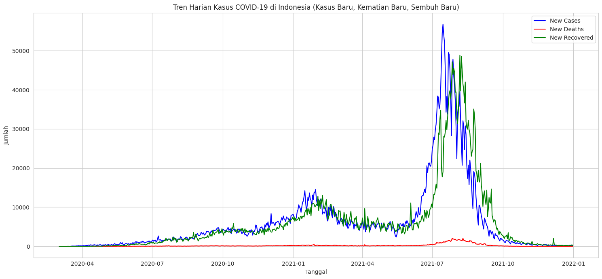
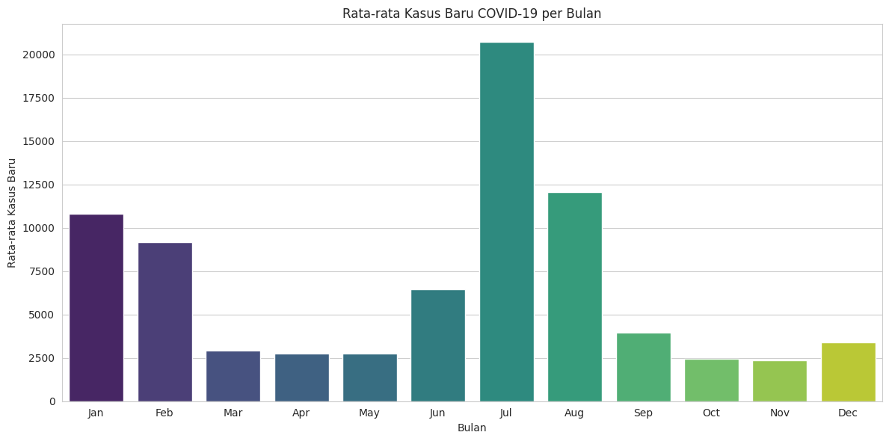

# Analisis COVID-19 dan Mobilitas Masyarakat Indonesia

Memprediksi jumlah kasus baru COVID-19 harian di Indonesia dengan menggabungkan data kasus dan data mobilitas masyarakat (Google Community Mobility Report 2020–2021).

Proyek kelompok (3 orang), mata kuliah **Data Analysis**, Universitas Multimedia Nusantara, 2025.

## Pertanyaan

Apakah perubahan mobilitas masyarakat (ke tempat kerja, transportasi umum, ritel, dan lainnya) bisa membantu memprediksi jumlah kasus baru COVID-19 di Indonesia?

## Data

| Dataset | Sumber |
|---|---|
| Kasus harian COVID-19 per provinsi | [Kaggle: COVID-19 Indonesia Dataset](https://www.kaggle.com/datasets/hendratno/covid19-indonesia) |
| Mobilitas masyarakat 2020 dan 2021 | Google COVID-19 Community Mobility Reports (Indonesia) |

Data mentah tidak disertakan di repositori ini. Unduh dari sumber di atas dan simpan di folder `data/` agar notebook bisa dijalankan.

## Langkah analisis

1. **Pembersihan dan integrasi data**: menyatukan data kasus nasional dengan data mobilitas berdasarkan tanggal.
2. **Analisis data eksploratif (EDA)**: tren kasus, kematian, dan kesembuhan harian, pola bulanan, serta hubungan mobilitas dengan kasus.
3. **Feature engineering**: lag kasus 1, 3, 7, dan 14 hari, rata-rata bergerak 7 hari, penanda periode PPKM, serta lag dan rata-rata bergerak untuk 6 kategori mobilitas.
4. **Pemodelan**: membandingkan 4 model regresi untuk memprediksi kasus baru harian.

## Hasil

| Model | RMSE | MAE | R² |
|---|---:|---:|---:|
| **Random Forest** | **1.975** | **860** | **0,77** |
| XGBoost | 2.070 | 1.068 | 0,75 |
| Gradient Boosting | 2.288 | 1.042 | 0,69 |
| Decision Tree | 2.333 | 960 | 0,68 |

Random Forest menjadi model terbaik: model ini menjelaskan sekitar 77% variasi kasus baru harian.

Grafik lain ada di folder [`images/`](images).

## Tools

Python · pandas · NumPy · matplotlib · seaborn · scikit-learn · XGBoost · Google Colab

## File

- `covid19_mobility_analysis.ipynb`: notebook lengkap beserta output
- `images/`: grafik hasil analisis

## Dokumen dan Bukti Pengerjaan

| File | Isi |
|---|---|
| [`laporan/paper_random_forest_covid19.pdf`](laporan/paper_random_forest_covid19.pdf) | Paper ilmiah (format IEEE) perbandingan Random Forest dan Gradient Boosting |

> Data pribadi anggota tim (nama, NIM, email) sudah dihapus dari dokumen.
